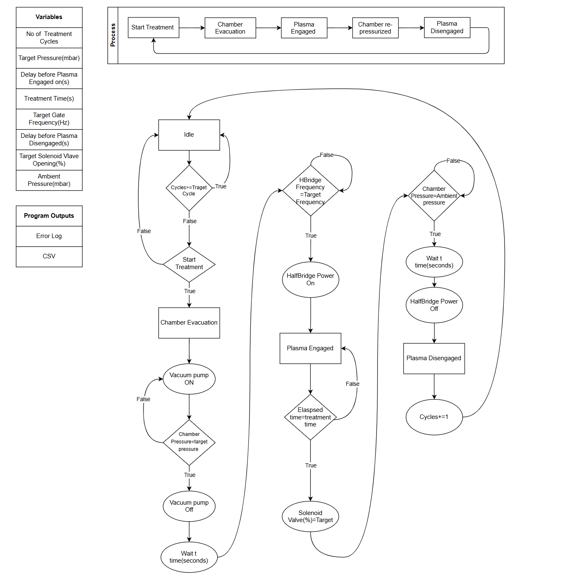

# Monroe Controller

## 1. System Overview

The Monroe Controller is a Python-based graphical user interface (GUI), developed using **PyQt6**, for controlling and monitoring automated plasma treatment cycles.

The system coordinates chamber evacuation, plasma generation, chamber re-pressurisation, and treatment-cycle repetition. It communicates with an Arduino-based controller to operate the vacuum pump, coolant pump, half-bridge amplifier, and gate drive signal. Chamber pressure is monitored independently through a USB pressure transmitter, enabling automatic progression between stages based on measured pressure.

The controller provides:

- Automated execution of configurable plasma treatment cycles.
- Real-time chamber pressure monitoring and visualisation.
- Independent control of the vacuum pump, coolant pump, half-bridge amplifier, gate drive, and proportional valve.
- Configurable pressure thresholds, delays, treatment duration, frequency, and valve opening.
- Automatic treatment-cycle counting and repetition.
- Fault monitoring, manual abort, and software shutdown functions.
- Optional CSV data logging and event/error reporting.
- Simulation of the treatment sequence without connected hardware.

## 2. Treatment Process Flowchart

The Monroe Controller follows the treatment sequence illustrated below.

The flowchart defines the treatment stages, decision conditions, actuator operations, and configurable parameters. Each cycle progresses through **Start Treatment → Chamber Evacuation → Plasma Engaged → Chamber Re-pressurised → Plasma Disengaged**, then repeats until the configured number of cycles is complete.

## 3. Graphical User Interface

The GUI provides a central interface for configuring, controlling, and monitoring the treatment system.

### 3.1 Treatment Control

The interface allows the operator to:

- Start an automated treatment run.
- Abort a run or request **ALL OFF**.
- Execute consecutive treatment cycles automatically.
- View the current treatment stage and its progress.
- Monitor completed cycles against the configured target.

### 3.2 Recipe Configuration

| Parameter | Function | Unit |
|---|---|---|
| Number of Treatment Cycles | Total cycles to execute | cycles |
| Target Pressure | Evacuation pressure threshold | bar |
| Delay Before Plasma Engaged (`t1`) | Delay after vacuum pump shutdown | s |
| Treatment Time | Duration of plasma engagement before venting begins | s |
| Target Gate Frequency | Requested gate drive frequency | Hz |
| Delay Before Plasma Disengaged (`t2`) | Delay after the ambient pressure threshold is reached | s |
| Target Proportional Valve Opening | Proportional valve setting during venting | % |
| Ambient Pressure | Reference pressure for completion of re-pressurisation | bar |

Further settings include frequency ramp increments, pressure tolerances, safety timeouts, and sensor communication parameters. The GUI retains configured values between sessions.

## 4. Automated Treatment Sequence

The GUI manages the sequence by evaluating sensor measurements, elapsed time, and hardware feedback.

### Step 0 – Idle

The controller waits for the operator to start treatment and checks the completed cycle count against the target. When the target has been reached, the run is complete. Otherwise, a Start command initiates a cycle.

### Step 1 – Chamber Evacuation

The vacuum pump is switched **ON** to reduce chamber pressure, and the coolant pump is switched **ON**. The coolant pump then stays on for the whole treatment run, through every cycle. The half-bridge and gate signal remain **OFF**, and the proportional valve is set to **0%**.

**Transition condition:** Chamber pressure is at or below the configured target pressure. The pump is then switched **OFF**.

### Step 2 – Delay Before Plasma Engagement

The pump remains off for the configured delay `t1`, allowing a pause between evacuation and gate-drive preparation.

**Transition condition:** `t1` has elapsed.

### Step 3 – Gate Frequency Ramp

The GUI increases the gate frequency from the ramp starting value to the configured target in the selected increments. A ramp increment of zero applies the target directly. The half-bridge power remains disabled during the ramp.

**Transition condition:** The frequency reported by the controller is within **1%** of the target.

### Step 4 – Plasma Engagement

The half-bridge amplifier is switched **ON**, with the gate signal operating at the target frequency. The vacuum pump remains off, and the proportional valve remains at 0%.

**Transition condition:** The configured treatment duration has elapsed.

### Step 5 – Chamber Re-pressurisation

The proportional valve is set to the configured vent opening. The half-bridge and gate drive remain active while the chamber re-pressurises.

**Transition condition:** Chamber pressure reaches or exceeds ambient pressure minus the configured tolerance.

### Step 6 – Delay Before Plasma Disengagement

The controller maintains the current treatment state for the configured delay `t2` after the ambient pressure threshold has been reached.

**Transition condition:** `t2` has elapsed.

### Step 7 – Plasma Disengagement

The half-bridge and gate drive are switched **OFF**, and the proportional valve is returned to **0%**. The completed cycle count is incremented by one. The GUI returns to Idle and either begins the next cycle when appropriate or marks the treatment run complete. When the run is complete, the coolant pump is switched **OFF**.

## 5. Hardware Control

The Arduino provides the hardware interface. It applies commands from the GUI and reports output status; the GUI determines the treatment-stage transitions.

### 5.1 Hardware Interfaces

| Component | Interface | Function |
|---|---|---|
| Vacuum Pump | Arduino D7 | Enables/disables chamber evacuation |
| Coolant Pump Relay | Arduino D2 | Enables/disables the coolant pump |
| Half-Bridge Amplifier | Arduino D8 | Enables/disables half-bridge power |
| Gate Drive | Arduino D9 | Generates adjustable-frequency output at 50% duty cycle |
| Proportional Valve | GP8302 DAC | Sets valve opening percentage |
| Flow Meter | Sensirion SFM4300-50-P, I2C `0x2A` (SDA/SCL) | Reports gas flow (slm) and gas temperature |
| Humidity Sensor | Sensylink CHT832X, I2C `0x44` (SDA/SCL) | Reports relative humidity (%RH) and temperature |
| Chamber Temp Sensors 1–3 | 3 × MAX31855 thermocouple converters, SPI: MISO D12, SCK D13, CS D3 / D4 / D5 | Report chamber temperatures (°C) |
| Pressure Transmitter | PC USB serial | Supplies chamber pressure directly to the GUI |

### 5.2 I2C Bus

The GP8302 DAC (`0x58`), the Sensirion SFM4300-50-P flow meter (`0x2A`) and the Sensylink CHT832X humidity sensor (`0x44`) share the Arduino Uno R3 I2C bus at 100 kHz. Each sensor connects to the same four lines:

| Sensor pin | Arduino Uno R3 |
|---|---|
| SDA | SDA (header pin beside AREF; same line as A4) |
| SCL | SCL (header pin beside AREF; same line as A5) |
| VDD / Vcc | SFM4300: supply per its datasheet · CHT832X: 5 V or 3.3 V (1.8–5.5 V rated) |
| GND | GND |

**Check before wiring:** confirm the SFM4300's supply voltage and I/O logic level in its datasheet. The Uno drives I2C at 5 V; if the sensor is a 3.3 V device, use a bidirectional I2C level shifter and pull-ups to the sensor's supply rather than connecting directly.

The firmware selects the **Air** calibration (`FLOW_CMD_START = 0x3608`); change this constant for O2, N2O or CO2. Scale factor and offset are read from the sensor at start-up, so no per-variant constants are hard-coded. The flow meter is optional: if it is absent the controller still runs, reports `FLOWOK=0`, and retries detection every 2 s. When present, each DATA line includes `FLOWOK=1 FLOW=<slm> FTEMP=<°C>`.

**CHT832X humidity sensor.** The CHT832X runs from 1.8 to 5.5 V, so it can be powered from the Uno's 5 V pin and connected directly to SDA/SCL. Fit a 0.1 µF capacitor close to Vcc/GND. The bus needs 4.7 kΩ pull-ups on SDA and SCL; add them if no other board on the bus already provides them. The 7-bit address depends on the part's ordering code: A = `0x44`, B = `0x45`, C = `0x46`, D = `0x47` (the datasheet lists these as 8-bit write addresses `0x88`–`0x8E`). Set `HUM_ADDR` in the firmware to match. At start-up the firmware checks the sensor's manufacturer ID (`0x5959`). It then triggers one non-blocking measurement per second, the maximum rate the datasheet recommends to avoid self-heating. Like the flow meter, the sensor is optional: if absent, the DATA line reports `HUMOK=0` and detection is retried every 2 s. When present, each DATA line includes `HUMOK=1 HUM=<%RH> HTEMP=<°C>`.

### 5.3 SPI Bus: Chamber Temperature

Chamber Temp Sensors 1–3 are MAX31855 K-type thermocouple-to-digital converters on the Uno's hardware SPI pins. The MAX31855 is read-only, so only MISO, SCK and a chip select per sensor are needed:

| MAX31855 pin | Arduino Uno R3 |
|---|---|
| SO (MISO) | D12, shared by all three |
| SCK | D13, shared by all three |
| CS | D3 = Sensor 1, D4 = Sensor 2, D5 = Sensor 3 |
| VIN / GND | Supply per the breakout board |

**Check before wiring:** the MAX31855 chip itself is a 3.0–3.6 V part. A breakout board with its own regulator and level shifting on SCK and CS (e.g. the Adafruit MAX31855 breakout) can be used directly at 5 V. A bare chip or a 3.3 V-only module needs level shifting on SCK and the CS lines. D10 and D11 are driven by the SPI peripheral but not used, so keep them free.

The firmware reads all three sensors every 250 ms at 4 MHz (SPI mode 0). Each DATA line includes `TCnOK=1 TCn=<°C>` for a good reading. For a fault it sends `TCnOK=0 TCnF=<bits>`, where the bits are 1 = open circuit, 2 = short to GND, 4 = short to VCC, and 8 = no response (MISO stuck high or low, e.g. the board is missing or unpowered). The thermocouple reading has 0.25 °C resolution.

### 5.4 Gate Drive Control

The gate drive and half-bridge power are controlled independently. The gate drive supports **0–40 kHz**, a **50% duty cycle**, frequency ramping, direct frequency selection, and reported-frequency monitoring. A frequency request of **0 Hz** disables the signal and holds D9 LOW.

### 5.5 Proportional Valve Control

The GP8302 DAC controls a valve opening request from **0–100%**. During normal automatic venting, the recipe setting is restricted to **0–30%** unless the override is enabled. The valve is commanded to 0% at the start of evacuation and after plasma disengagement.

## 6. Pressure Monitoring

The controller supports the **Omega PXM409-3.5BAUSBH** USB pressure transmitter, connected directly to the computer rather than through the Arduino.

### 6.1 Measurement Functionality

The GUI provides continuous pressure acquisition, display in **bar**, real-time pressure plotting, target and ambient reference lines, pressure-based stage transitions, and detection of missing measurements.

### 6.2 Pressure Sensor Configuration

| Setting | Software Default |
|---|---|
| Baud rate | 115200 |
| Read command | `P` |
| Command line ending | CR |
| Reported pressure unit | bar |
| Poll interval | 200 ms |
| Pressure data timeout | 2 s |

**Note:** These are the currently configured software defaults. The transmitter's command protocol and serial settings have not yet been verified against its official USBH command documentation. A sensor-test function displays identification and measurement responses for troubleshooting.

## 7. Real-Time Monitoring

### 7.1 Treatment Status

The GUI displays the current stage, active cycle, number of completed cycles, target cycle count, treatment progress, and relevant stage timing.

### 7.2 Pressure Visualisation

A live pressure chart displays chamber pressure alongside **target** and **ambient** pressure reference lines, allowing the operator to follow evacuation and re-pressurisation.

### 7.3 Hardware Status

The GUI displays feedback reported by the Arduino, including vacuum pump state, coolant pump state, half-bridge state, gate frequency, and proportional valve opening. These values update as status messages are received.

### 7.4 Input Sensors Tab

The **Input Sensors** tab monitors the inlet gas sensors on the Arduino I2C bus. Each reading has its own card with a live value and a trend chart covering the last 180 s:

| Card | Source | Unit |
|---|---|---|
| Inlet flow rate | SFM4300-50-P | slm |
| Inlet humidity | CHT832X | %RH |
| Inlet temperature | SFM4300-50-P (gas temperature) | °C |

Each card has a checkbox in its title that switches that reading on or off. A reading shows **no sensor** when the Arduino reports that sensor as not responding.

### 7.5 Chamber Temperature Sensors Tab

The **Chamber Temperature Sensors** tab shows Chamber Temp Sensors 1–3, the three MAX31855 thermocouple converters on the SPI bus. Each sensor has its own row with a checkbox and a live value, and all three are plotted as coloured traces on one chart covering the last 180 s. A faulted sensor shows **fault** with the reason: open circuit, short to GND, short to VCC, or no response from the MAX31855.

### 7.6 Switching Readings On and Off, and CSV Logging

On both tabs, unticking a reading switches it off. It then shows **Off**, its chart history is cleared, and its CSV column is left blank. The on/off choices are saved between sessions. A reading shows **—** when the connected firmware doesn't report it at all.

When CSV recording is on, each row also logs:
- `inlet_flow_slm` and `inlet_temp_c` (SFM4300)
- `inlet_humidity_pct` and `humidity_sensor_temp_c` (the CHT832X's own temperature, recorded with humidity)
- `chamber_temp_1_c`, `chamber_temp_2_c` and `chamber_temp_3_c`. A chamber column is blank while that sensor is faulted.

In simulator mode:
- Inlet flow rises while the chamber vents.
- Humidity holds near 45 %RH and inlet temperature at 22.8 °C.
- The chamber temperatures heat up while the half-bridge is on and settle back towards room temperature when it is off. They settle a little lower while the coolant pump runs.

## 8. Safety and Fault Handling

Software safety functions detect abnormal operating conditions and request shutdown when required.

### 8.1 Automatic Fault Detection

| Condition | Response |
|---|---|
| Evacuation timeout | Abort if target evacuation pressure is not reached in time |
| Re-pressurisation timeout | Abort if ambient pressure threshold is not reached in time |
| Pressure data loss | Abort if valid readings are absent for more than 2 seconds |
| Frequency target failure | Abort if the gate frequency does not reach the required target |
| Controller serial connection loss | Abort the treatment run |
| Firmware watchdog timeout | Arduino disables outputs if communication is absent for the watchdog period |

### 8.2 Manual Abort and ALL OFF

Both **Abort** and **ALL OFF** stop the treatment run and request the following safe output states:

- Pump: **OFF**
- Half-bridge: **OFF**
- Gate drive: **OFF**
- Coolant pump: **OFF**
- Proportional valve: **0%**

### 8.3 Communication Watchdog

The Arduino has a watchdog timeout of **5 seconds by default**. The GUI sends periodic keep-alive commands (normally once per second). If communication is lost for longer than the configured watchdog period, the firmware disables the controlled outputs.

**Safety limitation:** These are software-level safeguards and do not replace independent physical emergency stops, interlocks, or appropriately engineered electrical protections.

## 9. Simulation Functionality

The GUI includes a **SIMULATOR (no hardware)** mode for both the controller and pressure sensor. It reproduces the expected treatment behaviour without energising physical equipment.

The simulator models pump operation and pressure reduction, gate frequency ramping, half-bridge state changes, treatment timing, valve opening, chamber re-pressurisation, stage transitions, cycle counting, and responses to interrupted pressure data.

Simulation supports evaluation of the control sequence and GUI behaviour prior to connecting the physical system.
