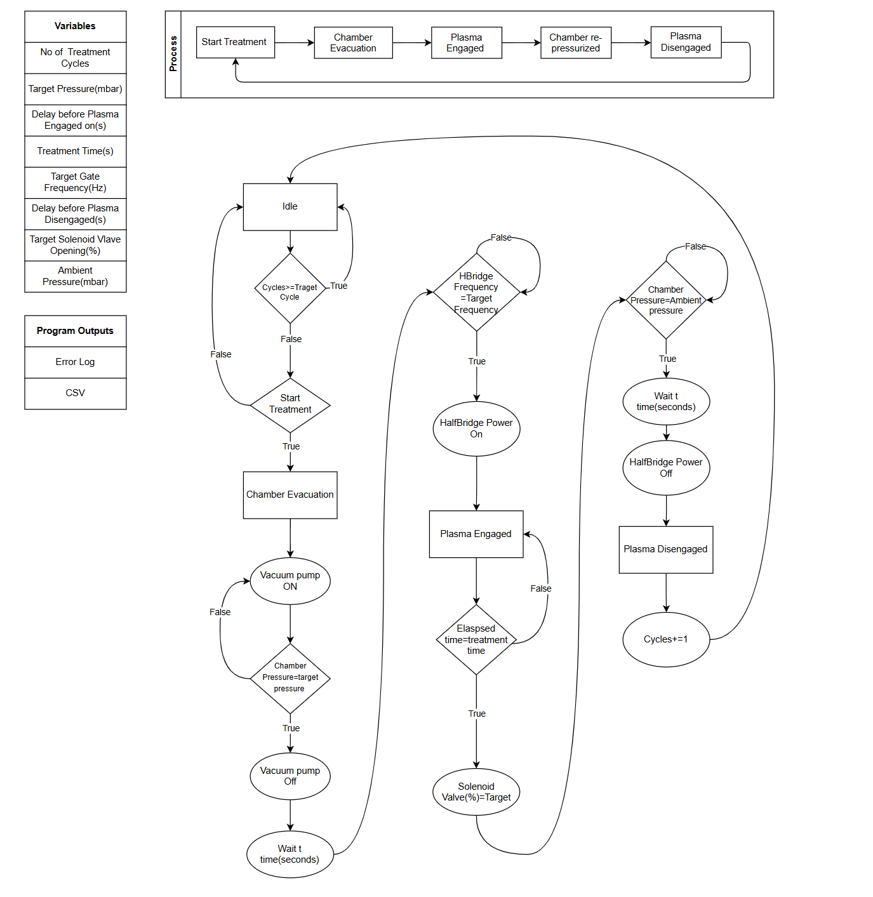

# Monroe Controller

## 1. System Overview

The Monroe Controller is a Python-based graphical user interface (GUI), developed using **PyQt6**, for controlling and monitoring automated plasma treatment cycles.

The system coordinates chamber evacuation, plasma generation, chamber re-pressurisation, and treatment-cycle repetition. It communicates with an Arduino-based controller to operate the vacuum pump, half-bridge amplifier, solenoid relay, and gate drive signal. Chamber pressure is monitored independently through a USB pressure transmitter, enabling automatic progression between stages based on measured pressure.

The controller provides:

- Automated execution of configurable plasma treatment cycles.
- Real-time chamber pressure monitoring and visualisation.
- Independent control of the pump, half-bridge amplifier, solenoid, gate drive, and proportional valve.
- Configurable pressure thresholds, delays, treatment duration, frequency, and valve opening.
- Automatic treatment-cycle counting and repetition.
- Fault monitoring, manual abort, and software shutdown functions.
- Optional CSV data logging and event/error reporting.
- Simulation of the treatment sequence without connected hardware.

## 2. Treatment Process Flowchart

The Monroe Controller follows the treatment sequence illustrated below.

The flowchart defines the treatment stages, decision conditions, actuator operations, and configurable parameters. Each cycle progresses through **Start Treatment → Chamber Evacuation → Plasma Engaged → Chamber Re-pressurised → Plasma Disengaged**, then repeats until the configured number of cycles is complete.

## 3. Graphical User Interface

The GUI provides a central interface for configuring, controlling, and monitoring the treatment system.

### 3.1 Treatment Control

The interface allows the operator to:

- Start an automated treatment run.
- Abort a run or request **ALL OFF**.
- Execute consecutive treatment cycles automatically.
- View the current treatment stage and its progress.
- Monitor completed cycles against the configured target.

### 3.2 Recipe Configuration

| Parameter | Function | Unit |
|---|---|---|
| Number of Treatment Cycles | Total cycles to execute | cycles |
| Target Pressure | Evacuation pressure threshold | mbar |
| Delay Before Plasma Engaged (`t1`) | Delay after vacuum pump shutdown | s |
| Treatment Time | Duration of plasma engagement before venting begins | s |
| Target Gate Frequency | Requested gate drive frequency | Hz |
| Delay Before Plasma Disengaged (`t2`) | Delay after the ambient pressure threshold is reached | s |
| Target Solenoid Valve Opening | Proportional valve setting during venting | % |
| Ambient Pressure | Reference pressure for completion of re-pressurisation | mbar |

Further settings include frequency ramp increments, pressure tolerances, safety timeouts, and sensor communication parameters. The GUI retains configured values between sessions.

## 4. Automated Treatment Sequence

The GUI manages the sequence by evaluating sensor measurements, elapsed time, and hardware feedback.

### Step 0 – Idle

The controller waits for the operator to start treatment and checks the completed cycle count against the target. When the target has been reached, the run is complete. Otherwise, a Start command initiates a cycle.

### Step 1 – Chamber Evacuation

The vacuum pump is switched **ON** to reduce chamber pressure. The half-bridge, gate signal, and solenoid remain **OFF**, and the proportional valve is set to **0%**.

**Transition condition:** Chamber pressure is at or below the configured target pressure. The pump is then switched **OFF**.

### Step 2 – Delay Before Plasma Engagement

The pump remains off for the configured delay `t1`, allowing a pause between evacuation and gate-drive preparation.

**Transition condition:** `t1` has elapsed.

### Step 3 – Gate Frequency Ramp

The GUI increases the gate frequency from the ramp starting value to the configured target in the selected increments. A ramp increment of zero applies the target directly. The half-bridge power remains disabled during the ramp.

**Transition condition:** The frequency reported by the controller is within **1%** of the target.

### Step 4 – Plasma Engagement

The half-bridge amplifier is switched **ON**, with the gate signal operating at the target frequency. The pump and solenoid remain off, and the proportional valve remains at 0%.

**Transition condition:** The configured treatment duration has elapsed.

### Step 5 – Chamber Re-pressurisation

The solenoid is switched **ON** and the proportional valve is set to the configured vent opening. The half-bridge and gate drive remain active while the chamber re-pressurises.

**Transition condition:** Chamber pressure reaches or exceeds ambient pressure minus the configured tolerance.

### Step 6 – Delay Before Plasma Disengagement

The controller maintains the current treatment state for the configured delay `t2` after the ambient pressure threshold has been reached.

**Transition condition:** `t2` has elapsed.

### Step 7 – Plasma Disengagement

The half-bridge and gate drive are switched **OFF**, the solenoid is switched **OFF**, and the proportional valve is returned to **0%**. The completed cycle count is incremented by one. The GUI returns to Idle and either begins the next cycle when appropriate or marks the treatment run complete.

## 5. Hardware Control

The Arduino provides the hardware interface. It applies commands from the GUI and reports output status; the GUI determines the treatment-stage transitions.

### 5.1 Hardware Interfaces

| Component | Interface | Function |
|---|---|---|
| Vacuum Pump | Arduino D7 | Enables/disables chamber evacuation |
| Solenoid Relay | Arduino D2 | Enables/disables the solenoid valve |
| Half-Bridge Amplifier | Arduino D8 | Enables/disables half-bridge power |
| Gate Drive | Arduino D9 | Generates adjustable-frequency output at 50% duty cycle |
| Proportional Valve | GP8302 DAC | Sets valve opening percentage |
| Pressure Transmitter | PC USB serial | Supplies chamber pressure directly to the GUI |

### 5.2 Gate Drive Control

The gate drive and half-bridge power are controlled independently. The gate drive supports **0–40 kHz**, a **50% duty cycle**, frequency ramping, direct frequency selection, and reported-frequency monitoring. A frequency request of **0 Hz** disables the signal and holds D9 LOW.

### 5.3 Proportional Valve Control

The GP8302 DAC controls a valve opening request from **0–100%**. During normal automatic venting, the recipe setting is restricted to **0–30%** unless the override is enabled. The valve is commanded to 0% at the start of evacuation and after plasma disengagement.

## 6. Pressure Monitoring

The controller supports the **Omega PXM409-3.5BAUSBH** USB pressure transmitter, connected directly to the computer rather than through the Arduino.

### 6.1 Measurement Functionality

The GUI provides continuous pressure acquisition, display in **kPa and bar**, real-time pressure plotting, target and ambient reference lines, pressure-based stage transitions, and detection of missing measurements.

### 6.2 Pressure Sensor Configuration

| Setting | Software Default |
|---|---|
| Baud rate | 115200 |
| Read command | `P` |
| Command line ending | CR |
| Reported pressure unit | bar |
| Poll interval | 200 ms |
| Pressure data timeout | 2 s |

**Note:** These are the currently configured software defaults. The transmitter's command protocol and serial settings have not yet been verified against its official USBH command documentation. A sensor-test function displays identification and measurement responses for troubleshooting.

## 7. Real-Time Monitoring

### 7.1 Treatment Status

The GUI displays the current stage, active cycle, number of completed cycles, target cycle count, treatment progress, and relevant stage timing.

### 7.2 Pressure Visualisation

A live pressure chart displays chamber pressure alongside **target** and **ambient** pressure reference lines, allowing the operator to follow evacuation and re-pressurisation.

### 7.3 Hardware Status

The GUI displays feedback reported by the Arduino, including pump state, solenoid state, half-bridge state, gate frequency, and proportional valve opening. These values update as status messages are received.

## 8. Safety and Fault Handling

Software safety functions detect abnormal operating conditions and request shutdown when required.

### 8.1 Automatic Fault Detection

| Condition | Response |
|---|---|
| Evacuation timeout | Abort if target evacuation pressure is not reached in time |
| Re-pressurisation timeout | Abort if ambient pressure threshold is not reached in time |
| Pressure data loss | Abort if valid readings are absent for more than 2 seconds |
| Frequency target failure | Abort if the gate frequency does not reach the required target |
| Controller serial connection loss | Abort the treatment run |
| Firmware watchdog timeout | Arduino disables outputs if communication is absent for the watchdog period |

### 8.2 Manual Abort and ALL OFF

Both **Abort** and **ALL OFF** stop the treatment run and request the following safe output states:

- Pump: **OFF**
- Half-bridge: **OFF**
- Gate drive: **OFF**
- Solenoid: **OFF**
- Proportional valve: **0%**

### 8.3 Communication Watchdog

The Arduino has a watchdog timeout of **5 seconds by default**. The GUI sends periodic keep-alive commands (normally once per second). If communication is lost for longer than the configured watchdog period, the firmware disables the controlled outputs.

**Safety limitation:** These are software-level safeguards and do not replace independent physical emergency stops, interlocks, or appropriately engineered electrical protections.

## 9. Simulation Functionality

The GUI includes a **SIMULATOR (no hardware)** mode for both the controller and pressure sensor. It reproduces the expected treatment behaviour without energising physical equipment.

The simulator models pump operation and pressure reduction, gate frequency ramping, half-bridge state changes, treatment timing, valve opening, chamber re-pressurisation, stage transitions, cycle counting, and responses to interrupted pressure data.

Simulation supports evaluation of the control sequence and GUI behaviour prior to connecting the physical system.
